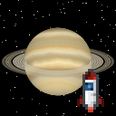

# 🚀 Interplanetary Stuff

A Minecraft **Fabric** mod (Java Edition **1.21.1**) for building rockets and travelling the Solar System.
It adds **30 worlds**, each with its own terrain, blocks, gravity and sky.



## Destinations

| System | Worlds | Rocket tier |
|---|---|---|
| ☿ Mercury | **Mercury**: scorched, cratered, a huge Sun and glowing solar crystals | 1 |
| ♀ Venus | **Venus**: lava seas, sulfur and basalt under a thick yellow haze | 1 |
| 🌍 Earth | **The Moon**: grey maria, highlands, craters and titanium; Earth hangs in the sky | 1 |
| ♂ Mars | **Mars**: red dunes, giant mountains, deep canyons, blue sunsets · **Phobos** · **Deimos** | 1 |
| 🪨 Asteroids | **Ceres** (glowing salt craters) · **Vesta** (diamonds) · **Psyche** (metal world, iridium) · **Bennu** (floating rubble field) | 2 |
| ♃ Jupiter | **Io** (lava and sulfur) · **Europa** (ice shell over a dark ocean with glowing life) · **Ganymede** · **Callisto** | 2 |
| ♄ Saturn | **Titan** (orange haze, dunes, methane lakes) · **Enceladus** (ice geysers) · **Mimas** · **Rhea** · **Iapetus** (two-toned) | 2 |
| ⛢ Uranus | **Miranda** (giant cliffs) · **Ariel** · **Umbriel** · **Titania** · **Oberon** | 3 |
| ♆ Neptune | **Triton**: pink nitrogen frost and geysers | 3 |
| ♇ Pluto | **Pluto**: Sputnik Planitia glacier and red Cthulhu Macula · **Charon** | 3 |
| Kuiper belt | **Eris** · **Haumea** (frost crystals) · **Makemake** | 3 |

Each world has:
- **Unique blocks**: a surface block, a rock block and craftable bricks, plus special blocks such as ores, ices,
  salt, sulfur, tholins, pumice, nickel-iron and crystal clusters (117 blocks in total).
- **Its own terrain**: craters with raised rims, maria, canyons, cliffs, dunes, mountain ridges, lava tubes,
  lava and methane seas, a frozen ocean, and asteroids floating over a void.
- **Real(ish) gravity**: you jump higher and fall more gently on small worlds, and mobs do too.
  Gravity never goes below 0.1 g, so tiny moons stay playable.
- **A custom sky**: a Milky Way skybox with nebulae, twinkling stars, a Sun that shrinks with distance, the parent
  planet hanging in the sky with real **phases**, Saturn's and Uranus' **rings**, sibling moons orbiting overhead,
  atmospheres (butterscotch Mars with **blue sunsets**, Venus' yellow murk, Titan's orange haze) and no clouds or rain.

## Getting started

1. **Space suit**: craft all four pieces (white wool and iron). Without the full suit your air runs out on
   other worlds, just like underwater.
2. **Rocket parts**: Iron Plating, a Nose Cone, Rocket Fins and a Rocket Engine (needs a Blast Furnace and
   Fire Charges).
3. **Tier 1 Rocket**: right-click a block to place it.
4. **Fuel**: craft Rocket Fuel (iron, coal, blaze powder) and right-click the rocket with it. Each canister adds
   25 fuel; a trip costs 25 × the destination's tier.
5. **Board** the rocket (right-click), press **R** to open the **Flight Computer**, pick a destination and
   press **Launch!** You get a countdown, liftoff and a landing on the new world. Sneak to get out.
6. To get home, fly back to **Earth**. You land at your spawn point.

A **Star Chart** (map + compass + glowstone) opens the star map anywhere, so you can browse destinations and facts.

### Progression

| Rocket | Needs | Reaches |
|---|---|---|
| Tier 1 | Overworld materials | Moon, Mercury, Venus, Mars, Phobos, Deimos |
| Tier 2 | Tier 1 rocket + **Titanium Plating** (Moon or Mars) + Advanced Engine (**sulfur** from Venus, **solar crystals** from Mercury) | + asteroids, moons of Jupiter and Saturn |
| Tier 3 | Tier 2 rocket + **Iridium Plating** (Psyche) + Fusion Engine (**methane ice** from Titan, solar crystal block) | everything |

Other resources: diamonds on Vesta, gold on Psyche, coal on Bennu, sulfur → gunpowder, methane ice → rocket fuel.
There is also **Astronaut Ice Cream**.

### Commands & game rules

- `/interplanetary travel <destination> [players]`: instant travel (operators)
- `/interplanetary info`: facts about the world you're on
- `/interplanetary destinations`: list everything
- `/gamerule interplanetarySpaceSuffocation false`: no air needed in space
- `/gamerule interplanetaryRocketsNeedFuel false`: free rides

There are also advancements for every system and a *Grand Tour* challenge for visiting all 30 worlds.

## Building

Requires **Java 21**.

```bash
./gradlew build          # mod jar in build/libs/
./gradlew runClient      # play in a dev client
./gradlew runGametest    # headless server: generates every world and runs the game tests
```

Install by putting the jar in your `mods` folder together with [Fabric API](https://modrinth.com/mod/fabric-api)
(Fabric Loader ≥ 0.16, Minecraft 1.21.1).

> Vanilla calls any world with data-driven dimensions "experimental" and shows a warning every time you open it.
> The mod's dimensions are safe, so it skips that warning screen.

CI also runs `./gradlew runCiServer`, which generates terrain on all 30 worlds and prints a small height map of
each one, and `./gradlew runScreenshotClient`, which flies a client through several worlds and screenshots the
skies.

## Project layout

- `src/main/java/com/randonaughtica/interplanetary/`
  - `body/`: the celestial bodies (gravity, atmosphere, tier, sky look) and star map systems
  - `entity/RocketEntity.java`: the rocket (fuel, countdown, launch, landing)
  - `world/`: gravity, space-suit hazard, travel and landing logic, crater and boulder features
  - `client/`: the sky renderer, rocket model/renderer/HUD and the flight computer screen
  - `dev/`, `client/dev/`, `gametest/`: the world self-test, the screenshot tour and the game tests
- `tools/generate.py`: **generates all worldgen, blocks, items, recipes, loot tables, tags, advancements,
  language entries and every texture** (procedurally, with numpy and Pillow). Edit its tables and re-run:
  ```bash
  pip install numpy pillow
  python3 tools/generate.py && python3 tools/validate.py
  ```
- `tools/validate.py`: static checks for missing models, textures, translations and worldgen references.
- `.github/workflows/build.yml`: CI that builds the mod, boots a test server that generates every world, and
  fails on data errors.
